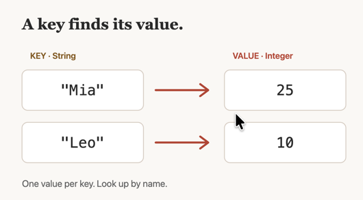

# Vehicle Inventory Application
What makes a good README?
Firstly, the capstone project requirements document has some points that you should follow:

- Describe your project.
- Include instructions for how to run the project.

## README scoring

The rubric's **Documented project** criterion describes these performance levels and here's how you do a Markdown table:

| Score | Level | Expectations |
| :---: | --- | --- |
| 1 | Beginning | No documentation, or a README that says nothing useful. |
| 2 | Approaching | The README is sparse, incomplete, or copied from the instructions. |
| 3 | Meeting | The README explains **what the project is, how to run it, and what it does**. Required project tracking is present and current. |
| 4 | Exceeding | Documentation covers everything required and shows how the work progressed. The task history reflects real development. |
| 5 | Leading | Documentation also covers optional and bonus work and lets someone else pick up the project without assistance. |

## README tips and examples

Make effective use of Markdown formatting basics, like this little bullet list:
  * option 1
  * option 2

Use code fences to show off some code you're proud of:
Here's my search using a hash map:
```java
    public static void searchForMakeModel(String searchMakeModel, HashMap<String, Vehicle> vehicleMap) {
        Vehicle v = vehicleMap.get(searchMakeModel);
        v.display();
    }
```

Lists are a good way to share a menuing system:

## Original menu:
1. List all vehicles
2. Search by make/model  
3. Search by price range 
4. Search by color 
5. Add a vehicle 
6. Quit

## New menu:
1. List all vehicles
2. Reports
   1. Search by make/model  
   2. Search by price range 
   3. Search by color 
3. Add a vehicle 
4. Quit

You can include images simply by pasting them into the IDEA editor.  If you do that, you should make sure your images are organized and have meaningful names.
